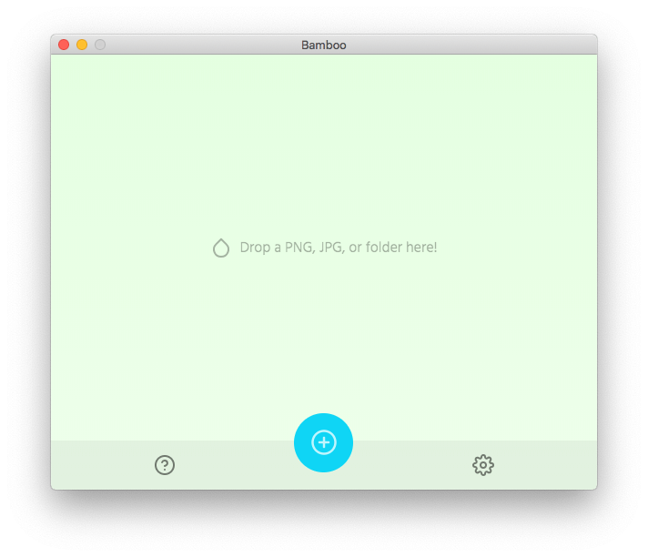

<p align="center">
  
</p>
<h1 align="center">Bamboo – Apple Silicon fork</h1>
<p align="center">A cross-platform TinyPNG client 🌱🎍</p>

> [!IMPORTANT]
> **This repository is a fork of the original, no longer maintained project [christopherwk210/bamboo](https://github.com/christopherwk210/bamboo).**
>
> It only provides a **recompiled build for Apple Silicon processors (M1/M2/M3/M4…)**, prepared with the help of the AI **Claude**, packaged as an **unsigned .app application**.
>
> **The app's features are exactly the same as in the original – no new functionality was added, it was only recompiled for Apple Silicon.** The app was created by [Chris Anselmo](https://github.com/christopherwk210).
>
> Should the original project be revived and release an official Apple Silicon version, this fork will become obsolete and will be discontinued – please use the official release instead.

Bamboo allows you to use your [TinyPNG](https://tinypng.com/) API key to losslessly compress local PNG/JPG's on your computer. It works by uploading your image to TinyPNG, then downloading the compressed output. In order to use this client, you'll need to get an [API key](https://tinypng.com/developers).

<p align="center">
  
</p>

# Download

Download the app: **[Bamboo_macOS_Apple_Silicon.zip](https://github.com/oubrecht-com/bamboo-tinypng-apple-silicon/releases/download/bamboo/Bamboo_macOS_Apple_Silicon.zip)** (from [Releases](https://github.com/oubrecht-com/bamboo-tinypng-apple-silicon/releases))

1. Download and unzip `Bamboo_macOS_Apple_Silicon.zip`.
2. Move `Bamboo.app` to your **Applications** folder (`/Applications`).

### Running an unsigned app

The app is not signed or notarized by Apple, so macOS will block it on first launch ("app is damaged" or "developer cannot be verified"). To open it:

- **Option A:** Right-click `Bamboo.app` → **Open** → click **Open** again in the dialog.
  On newer macOS versions: **System Settings → Privacy & Security** → click **Open Anyway** next to Bamboo.
- **Option B (Terminal):** remove the quarantine attribute:
  ```
  xattr -dr com.apple.quarantine /Applications/Bamboo.app
  ```

# Development

The source code modified for Apple Silicon is located in [`bamboo-master`](./bamboo-master).

```
$ cd bamboo-master
$ npm install
$ npm start
```

To make a build:
```
$ npm run build.mac    # macOS, arm64 (Apple Silicon)
or
$ npm run build.win    # Windows, x64
```

The build output is placed in the `bin/` folder (e.g. `bin/Bamboo-darwin-arm64/Bamboo.app`).

# License

MIT – © 2018 Chris Anselmo, Apple Silicon build © 2026 OUBRECHT.com, see [LICENSE](./bamboo-master/LICENSE).

Bamboo is not affiliated with nor endorsed by Tinify/TinyPNG/TinyJPG.
